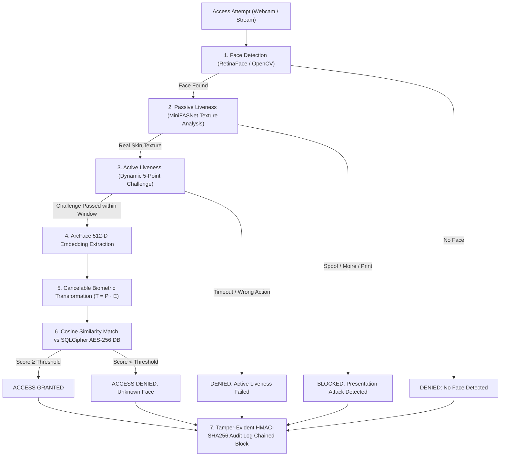

# Secure Face Recognition System (SFRS)

[](https://github.com/Yassine-hn/secure-face-recognition-system/actions)
[](https://www.python.org/)
[](docs/deployment.md)
[](docs/deployment.md)
[](docs/deployment.md)
[](#1-cancelable-biometric-templates)
[](LICENSE)

An enterprise-grade, privacy-preserving face recognition and student authentication system built with deep learning and cryptographic defense-in-depth principles. 

Designed for high-security campus attendance and access control, SFRS guarantees biometric privacy under **GDPR Article 9** via **Cancelable Biometrics**, prevents presentation spoofing attacks via **Multi-Factor Liveness Detection (Passive MiniFASNet + Active Challenge Orchestration)**, and provides tamper-evident accountability via **HMAC-SHA256 Hash Chained Audit Trails**.

---

## 🚀 Live Cloud Demo & Quick Links

- **Interactive Cloud Web Demo**: Run the system directly in your web browser with zero installation on free cloud hosting. See the [Deployment & Hosting Guide](docs/deployment.md).
- **Dual Interface**: Supports both a **Cross-Platform Streamlit Web App** (for cloud hosting & browser webcam) and a **Native CustomTkinter Desktop Application** (for high-fps local kiosk stations).
- **Zero-Setup Docker**: Run with a single command: `docker compose up --build`.

---

## Table of Contents

- [System Overview](#system-overview)
- [Pipeline & System Layers](#pipeline--system-layers)
- [Project Structure](#project-structure)
- [Security Measures](#security-measures)
- [Quickstart & Running the Project](#quickstart--running-the-project)
  - [1. Web Interface (Browser)](#1-web-interface-browser)
  - [2. Desktop Application (CustomTkinter GUI)](#2-desktop-application-customtkinter-gui)
  - [3. Docker / Containerized Run](#3-docker--containerized-run)
  - [4. Running Tests & Security Preflight](#4-running-tests--security-preflight)
- [Cloud Hosting & Deployment (Free Tier)](#cloud-hosting--deployment-free-tier)
- [Tools, Frameworks & Models](#tools-frameworks--models)
- [What Is Excluded from Version Control](#what-is-excluded-from-version-control)

---

## System Overview

The system operates both as a local desktop workstation application and a responsive web application. It combines:

- **RetinaFace** for high-precision face detection across variable lighting, angles, and occlusions (with OpenCV Haar Cascade fallback).
- **ArcFace** (via InsightFace) for metric-learning 512-dimensional normalized face embeddings.
- **Cancelable Biometrics** using secret random orthogonal projection matrices ($T = P \cdot E$), ensuring that stored templates cannot be inverted to reconstruct raw faces or cross-matched across external databases.
- **MiniFASNet v2** for passive texture and frequency anti-spoofing (defeats printouts and screen replays).
- **MediaPipe Face Mesh** for active dynamic challenge-response (eye blink, head yaw/pitch, mouth movement, smile, iris tracking).
- **SQLCipher AES-256** encrypted database storage with master keys protected via OS Credential Store (Keyring).
- **HMAC-SHA256 Hash Chaining** creating an immutable blockchain-style audit trail of every access decision.

---

## Pipeline & System Layers

Every access attempt passes through sequential verification gates. A failure at any gate terminates the authentication session immediately:



### Layer Breakdown

| Layer | Purpose | Threats Defeated |
|---|---|---|
| **Face Detection** | Localize and crop facial ROI | Empty frames, off-center artifacts |
| **Passive Liveness** | High-frequency texture & reflection analysis | 2D color printouts, phone/tablet screen replays |
| **Active Liveness** | Non-deterministic challenge orchestration (3s window) | Pre-recorded video injection, 3D static masks |
| **Cancelable Biometrics** | Random projection transform ($T = P \cdot E$) | Database breaches, embedding inversion attacks |
| **Encrypted Storage** | SQLCipher AES-256-CBC at rest | Physical disk theft, offline database scraping |
| **Audit Log Chain** | HMAC-SHA256 blockchain-style append-only log | Log tampering, repudiation, audit erasure |

---

## Project Structure

```
secure-face-recognition-system/
│
├── main.py                        # Unified entry point (Desktop GUI, Web UI, Security CLI)
├── Dockerfile                     # Optimized CPU-based container for local & cloud hosting
├── docker-compose.yml             # Single-command local containerized stack
├── requirements.txt               # Complete pinned Python dependencies
├── requirements-ci.txt            # Minimal dependencies for GitHub Actions CI
├── pyproject.toml                 # Packaging & tool configurations
├── README.md                      # Project documentation & portfolio showcase
│
├── web/                           # 🌐 Interactive Web Application
│   ├── app.py                     # Streamlit web dashboard (Webcam, Enrollment, Liveness, Audit, ROC)
│   └── sample_faces/              # Synthetic test images for 1-click cloud demo testing
│
├── core/                          # 🧠 Biometric Engine
│   ├── services.py                # Centralized AppServices container and factory
│   ├── detector.py                # RetinaFace & OpenCV Haar Cascade face detection
│   ├── embedder.py                # ArcFace 512-D embedding extraction
│   ├── matcher.py                 # Cosine similarity and threshold matcher
│   └── enrollment.py              # Enrollment service with cancelable template integration
│
├── liveness/                      # 🛡️ Anti-Spoofing & Liveness Pipeline
│   ├── passive.py                 # MiniFASNet CNN texture-based anti-spoofing
│   ├── active.py                  # Challenge-response orchestration and session tokens
│   ├── silent_face_wrapper.py     # Silent-Face-Anti-Spoofing model loader
│   └── checks/                    # MediaPipe challenge evaluators (blink, head pose, mouth, smile, iris)
│
├── security/                      # 🔒 Cryptography & Database Security
│   ├── cancelable.py              # Cancelable random projection transformer & seed manager
│   ├── database.py                # SQLCipher AES-256 database with SQLite fallback
│   ├── key_manager.py             # OS Credential Store (keyring) & environment key manager
│   ├── audit_log.py               # HMAC-SHA256 hash-chained tamper-evident audit logger
│   └── runtime_checks.py          # Production security preflight assertions
│
├── ui/                            # 🖥️ CustomTkinter Desktop GUI
│   ├── app.py                     # Desktop GUI router and main window
│   ├── camera_widget.py           # Real-time multi-threaded OpenCV camera widget
│   ├── enrollment_screen.py       # Desktop enrollment screen
│   ├── recognition_screen.py      # Desktop recognition screen
│   ├── liveness_screen.py         # Desktop active liveness challenge screen
│   ├── audit_screen.py            # Desktop audit log viewer with pagination
│   └── settings_screen.py         # Desktop threshold and configuration screen
│
├── evaluation/                    # 📊 Benchmark & Evaluation Toolkit
│   ├── benchmark.py               # EER, FAR, FRR threshold sweep benchmark
│   ├── metrics.py                 # ROC curve, AUC, and EER calculations
│   └── attack_sim.py              # Attack presentation simulation runner
│
├── tests/                         # 🧪 Automated Test Suite (63 unit tests)
├── scripts/                       # 🔧 Diagnostic and landmark calibration utilities
├── models/                        # 📦 Model weights placeholder and setup guides
└── docs/                          # 📚 Comprehensive technical specifications
    ├── deployment.md              # Free cloud deployment guide (Hugging Face / Streamlit Cloud)
    ├── architecture.md            # System architecture and data flow specifications
    ├── threat_model.md            # Comprehensive threat model & attack mitigations
    └── release_checklist.md       # Pre-release security and quality checklist
```

---

## Security Measures

### 1. Cancelable Biometric Templates
- **Threat Mitigated**: Biometrics cannot be revoked or changed once stolen. Raw ArcFace vectors stored in a database could allow attackers to reconstruct the user's face (biometric inversion attack) or cross-match the user across other systems.
- **Defense**: SFRS applies a non-invertible, distance-preserving random projection matrix $P \in \mathbb{R}^{512 \times 512}$ drawn from a Gaussian distribution:
  $$T = P \cdot E$$
- **Revocability**: If the database is ever compromised, the system admin generates a new seed for $P$. Old templates become instantly invalid, protecting the student's true biometric identity.
- **Implementation**: [`security/cancelable.py`](security/cancelable.py)

### 2. Multi-Factor Anti-Spoofing
- **Passive Liveness**: MiniFASNet analyzes frequency spectrum and specular reflections on the face crop to classify printouts or screens without requiring user action ([`liveness/passive.py`](liveness/passive.py)).
- **Active Liveness**: The orchestrator randomly issues 2-3 dynamic challenges (e.g. *Blink twice*, *Turn head left*, *Smile*, *Open mouth*) within a strict 3-second window, bound to an ephemeral session token ([`liveness/active.py`](liveness/active.py)).
- **TOCTOU Defense**: Facial recognition is bound to the exact frame that passes the active challenge, preventing an attacker from swapping a photo for their real face.

### 3. SQLCipher AES-256 Storage & Key Management
- Templates are stored in an encrypted database using SQLCipher (AES-256-CBC).
- Master encryption keys are retrieved dynamically from the OS Credential Store (Windows Credential Manager / macOS Keychain / Linux Secret Service) and never stored in plaintext on disk ([`security/key_manager.py`](security/key_manager.py)).

### 4. Tamper-Evident Audit Trail
- Every access attempt generates an audit record linked to the previous entry:
  $$\text{HMAC}_i = \text{HMAC-SHA256}(K, \text{HMAC}_{i-1} \parallel \text{timestamp} \parallel \text{result} \parallel \text{hash}(\text{student\_id}) \parallel \text{metadata})$$
- Modifying or deleting any historical log record breaks the cryptographic chain, immediately detected during audit verification ([`security/audit_log.py`](security/audit_log.py)).

---

## Quickstart & Running the Project

### Prerequisites
- Python 3.10 or 3.11
- A standard webcam (for live camera features)
- Git

### Installation

```bash
# 1. Clone the repository
git clone https://github.com/Yassine-hn/secure-face-recognition-system.git
cd secure-face-recognition-system

# 2. Create and activate a virtual environment
python -m venv .venv
source .venv/bin/activate  # On Windows: .venv\Scripts\activate

# 3. Install dependencies
pip install --upgrade pip
pip install -r requirements.txt
```

---

### 1. Web Interface (Browser)

The modern interactive web dashboard runs in any web browser and supports webcam authentication, student enrollment, liveness testing, audit log exploration, and interactive ROC analytics:

```bash
python main.py --web
# or
streamlit run web/app.py
```
Open **[http://localhost:7860](http://localhost:7860)** in your browser.

---

### 2. Desktop Application (CustomTkinter GUI)

To launch the native desktop application with real-time OpenCV camera widgets:

```bash
python main.py
```

---

### 3. Docker / Containerized Run

To run the entire system inside Docker without installing dependencies locally:

```bash
# Build and run with Docker Compose
docker compose up --build

# Open http://localhost:7860 in your browser
```

---

### 4. Running Tests & Security Preflight

```bash
# Run unit tests (63 tests)
python -m unittest -q

# Run with pytest
pytest tests/ -v

# Run runtime security preflight check
SFRS_MODE=development python main.py --validate-security
```

---

## Cloud Hosting & Deployment (Free Tier)

You can host this project with a live public URL for your GitHub profile and portfolio completely free:

1. **Hugging Face Spaces (Free 16 GB RAM + 2 vCPUs)**:
   - Create a new Space on [Hugging Face](https://huggingface.co/)
   - Select **Streamlit** SDK (or **Docker**)
   - Connect this repository and set entrypoint to `web/app.py`
   - Your live demo URL is ready immediately!

2. **Streamlit Community Cloud (Free 1-Click Deploy)**:
   - Connect your GitHub repository at [share.streamlit.io](https://share.streamlit.io/)
   - Set Main file path to `web/app.py` and click **Deploy**.

For detailed, step-by-step instructions, see **[docs/deployment.md](docs/deployment.md)**.

---

## Tools, Frameworks & Models

| Component | Framework / Library | Role |
| :--- | :--- | :--- |
| **Face Detection** | `insightface` / `RetinaFace`, `opencv-python` | Face bounding box localization & landmarks |
| **Face Recognition** | `insightface` / `ArcFace 512-D`, `onnxruntime` | Normalized feature embedding extraction |
| **Liveness Analysis** | `mediapipe` (Face Mesh), `torch`, `MiniFASNet` | EAR/MAR checks, head pose, texture anti-spoofing |
| **Cancelable Biometrics**| `numpy`, `scipy` | Orthogonal random projection transform |
| **Database Encryption** | `sqlcipher3`, `keyring`, `cryptography` | AES-256 database at rest & OS credential management |
| **Audit Logging** | `hmac`, `hashlib` | SHA-256 blockchain-style hash chain integrity |
| **Frontend Options** | `streamlit` (Web) & `customtkinter` (Desktop) | Responsive web dashboard & native desktop GUI |
| **Evaluation** | `scikit-learn`, `pandas`, `matplotlib` | ROC curves, DET plots, EER, and FAR/FRR analytics |

---

## What Is Excluded from Version Control

The following sensitive items are protected by `.gitignore` and must never be committed:
- `data/` — SQLite databases, enrolled biometric templates, and audit logs.
- `.env` — Local secrets and database master keys.
- `models/*.pth`, `models/*.onnx` — Heavy neural network weights (downloaded on demand).
- `.venv/`, `__pycache__/` — Local environments and bytecode caches.

---

## License

This project is licensed under the [MIT License](LICENSE).
